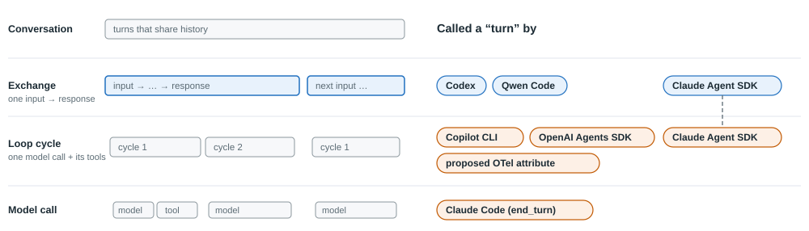
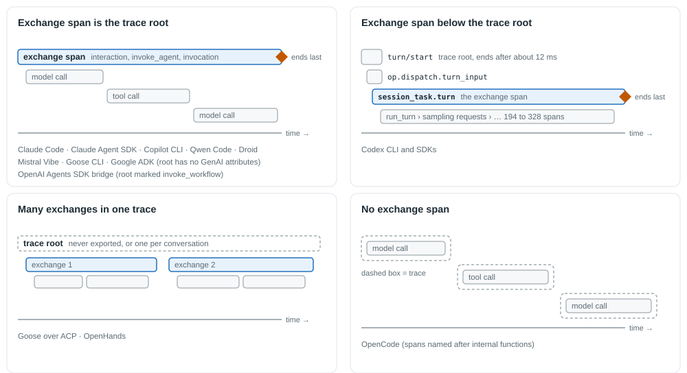
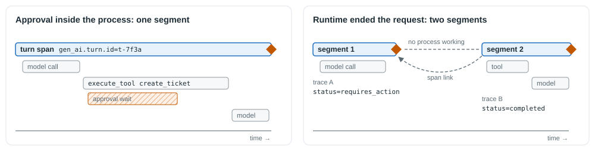
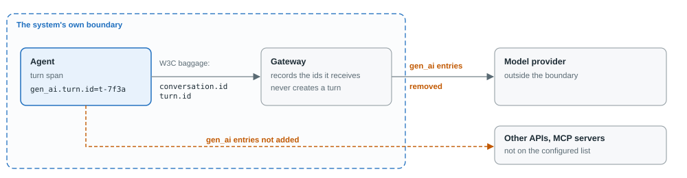

# Agent Behavior Trace Model: what is a turn?

*Proposal for the WG meeting, October 28, 2026.*

Status: Working group proposal, reviewed at the 2026-10-28 meeting. Converted from the WG working document.

On October 14 the WG reviewed seven gaps in how coding agents, agent SDKs and
AI gateways use OpenTelemetry
([Agent Behavior Trace Model: main gaps found](AGENT-BEHAVIOR-TRACE-MODEL-GAPS.md)).
One of them was that nothing marks where a conversation or a turn starts.

This document proposes how OpenTelemetry should define and record a turn.
Part 1 shows the evidence briefly, with traces. Part 2 is the proposal for
the WG to review and then take to the OpenTelemetry GenAI SIG.

All examples come from projects that offer OpenTelemetry support, natively
or through a first-party or OpenTelemetry package. The GenAI conventions are
in Development status, so differences are expected, and none of this is a
criticism of any one project. Each example is marked **captured** (the
export was captured and read), **source** (read from the code at a pinned
release) or **docs**. All examples are judged against the GenAI conventions
at a pinned revision: `semantic-conventions-genai` main at `4f85037`
(October 6, 2026). The captured traces are in Appendix A, and the versions
and telemetry settings for each capture are in Appendix B. Each gap in
section 2 is classified, so that a convention gap can be told apart from a
project defect.

# Part 1: The evidence

## 1. What is a "turn"?

The conventions define model calls, tool calls and agent invocations, and a
conversation key. They do not define a turn: one exchange in which an
agentic system receives an input and produces its response. Projects fill
the gap their own way, including the SDKs most agents are written with, and
the word "turn" is used for four different things.



*Figure 1. The same word, "turn", is used at three different levels. The
Claude Agent SDK uses it at two of them.*

**One exchange: an input, and everything the system does until it responds**
- Claude Code: `claude_code.interaction` covers one user prompt (captured).
  The Claude Agent SDK documents a turn as "a user message and assistant
  response" (source).
- Google ADK: an invocation "starts with a user message and ends with a
  final response" (source); its root span is `invocation` (captured).
- OpenAI Agents SDK: one `Runner.run` handles one input, and is one trace
  (captured).
- Codex: `turn.id` on the `session_task.turn` span (captured).
- Qwen Code: `qwen-code.turn_status` on the exchange span (captured).

**One loop cycle: one model call and the tools it asks for**
- OpenAI Agents SDK: a `turn` span inside each run, and the `max_turns`
  limit (source).
- Google ADK: calls this a "step", which "calls the LLM only once" and then
  the tools it requests (source).
- Claude Agent SDK: although its documentation defines a turn as an
  exchange, its `max_turns` limit can end the loop inside a single query
  (`terminal_reason="max_turns"`), so in practice it counts cycles within
  one exchange (source).
- GitHub Copilot CLI: `github.copilot.turn_id` is the index of a model call
  inside one user message (0, 1, ...), and `github.copilot.turn_count`
  counts them (captured).
- A proposed OpenTelemetry attribute, `gen_ai.agent.turn.count`, uses this
  meaning.

Several SDKs call this unit a **step**: Google ADK, the Vercel AI SDK
(`step N` spans), Mastra (`agent_step`), Haystack (`haystack.agent.step`)
and smolagents (`Step N`) (source).

**The model has finished**
- Claude Code: `stop_reason=end_turn` on model-call spans means the model
  stopped asking for tools, not that the exchange ended (captured).

**One speaker's slot in a multi-agent chat**
- AutoGen group chat wraps each agent's turn in an `invoke_agent` span
  (source).

An OTel collector that turns spans into a "turns" count gets exchanges for
Claude Code, Google ADK and Codex, and model calls for Copilot CLI. The
OpenAI Agents SDK and the Claude Agent SDK each use the word both ways. No
collector configuration can fix this in a generic way, because the
telemetry does not say which meaning is in use. **A shared convention is
needed: one definition of a turn, and one way to mark it in a trace.**

## 2. The gaps, in short

The span trees behind these examples are in Appendix A.



*Figure 2. Where the exchange sits in a trace, across the projects
captured.*

Each gap is classified as a **missing convention** (the conventions do not
cover it), an **interpretation issue** (the conventions cover it and
projects read them differently), **non-adoption** (the conventions cover it
and a project does not follow them yet) or an **instrumentation defect** (a
project bug, whatever the conventions say).

- **The word "turn."** *Missing convention.* The term is not defined, and
  it is used for four different things (section 1).
- **Start.** *Missing convention.* No project marks where an exchange
  starts. The exchange span is the trace root in Claude Code, Copilot CLI,
  Qwen Code, Factory Droid, Mistral Vibe and the Goose CLI. It sits below
  the root in Codex. In Google ADK the root is an `invocation` span with no
  GenAI attributes, and the OpenAI Agents SDK bridge marks it as a
  workflow. One trace holds many exchanges in Goose over ACP and OpenHands.
  OpenCode has no exchange span. Nothing says what started an exchange: a
  person, another agent, a schedule or a notification. Claude Code's
  exchange span has no `gen_ai.operation.name` (*non-adoption*).
- **End.** *Missing convention.* No project marks the end (all captured):
  - Claude Code sent one 8-second exchange in three export requests, root
    last.
  - With a background subagent, children arrived after the root.
  - Copilot CLI and Droid report the finish reason `stop` both for a tool
    request and for a final answer (*interpretation issue*). Codex puts no
    finish reason on spans and leaves the exchange span's status unset
    (*instrumentation defect*).
- **Continuation.** *Missing convention.* One exchange can span several
  requests or processes: an approval recorded by a web front end and
  continued by a worker, a tool that runs in the client's browser, a
  durable runtime that recovers. Nothing ties the pieces together.
- **Conversation.** *Interpretation issue* where `gen_ai.conversation.id`
  is set with different meanings: a conversation across runs (Pydantic
  AI), a task (CrewAI), a single run (Koog), a memory thread (Mastra), or a
  service-side conversation (Foundry). *Non-adoption* where other keys
  (`session.id`, `thread.id`, private keys) or no key at all are used, as
  in the Claude Agent SDK, the OpenAI Agents SDK by default, LlamaIndex,
  Haystack, AG2, smolagents and the Vercel AI SDK. *Missing convention*
  for resumed and forked conversations, which lose their link to the
  original: in the Claude Agent SDK a fork gets a new `session.id` with
  nothing pointing back, `interaction.sequence` starts again at 1 in each
  process, and a model call that titles the session is a trace of its own,
  outside any exchange.
- **Gateways.** *Missing convention.* A gateway sees model calls, not
  exchanges, and no carrier is defined for a client to send its
  conversation to a gateway. Each gateway reads its own: LiteLLM reads
  several headers into `gen_ai.conversation.id`, Bifrost reads
  `x-bf-session-id` into `session.id`, Envoy AI Gateway maps an
  `agent-session-id` header to `session.id`, and Kong, Apache APISIX,
  agentgateway and Tyk AI Studio record no session (source and docs).

# Part 2: The proposal

## 3. Definitions

- **Turn.** One exchange between a caller and an agentic system. It starts
  when the system receives one input from its caller, and ends when the
  system has produced its response to that input or has stopped. The
  caller can be a person, another agent, or a system such as a scheduler.
  The system can be one agent, a workflow, a harness or a hosted service:
  the turn does not depend on how it is built.
- **Step.** One cycle of an agent loop: one model call and the tool calls
  it requests. A step is not the same as a model call, because it also
  groups the tool calls that the model call asked for. A turn contains one
  or more steps. Google ADK, the Vercel AI SDK, Mastra, Haystack and
  smolagents already use "step" for this unit. The conventions should not
  use "turn" for it. Appendix C covers the overlap with the proposed step
  convention.
- **Turn segment.** One continuous run of a turn in one process, recorded
  by one turn span. A segment begins when a process starts or resumes work
  on the turn. It ends when that process stops working on the turn: the
  turn completes, fails or is cancelled, or the runtime ends the request or
  the process while the turn waits for something outside it, such as an
  approval or a result from the client (status `requires_action`). A wait
  inside a running process, such as an approval prompt the process waits
  on, does not end a segment. Almost every turn has exactly one segment.

**Alignment with the AAIF taxonomy.** The AAIF Common Taxonomy and
Landscape workstream has no entry yet for turn, step or conversation.
The definitions above use its accepted terms, and are meant to sit beside
them:

- A turn can be handled by an agent, an agentic workflow or a harness, as
  the taxonomy defines them. Its caller can be a user, which an open
  taxonomy proposal defines as a human or an agent.
- Subagents and handoffs inside a turn stay part of that turn.
- A step in this sense is a cycle of an agent loop, not an Activity. In the
  taxonomy an Activity is a unit of work in an agentic workflow, which is
  what the proposed OpenTelemetry step convention records.
- Turns, steps and segments are units of an agent trajectory, which
  the taxonomy defines as "the observable path an agent could take or has
  taken through a task or conversation across invocations, steps,
  handoffs, checkpoints, and outcomes". An approval is a checkpoint in a
  human-in-the-loop workflow.
- The taxonomy's Session, still under discussion, is shared working state,
  and a conversation can span several sessions. That distinction stays in
  the taxonomy. This proposal does not change the OpenTelemetry attribute's
  wording, which names session and thread as other words for a
  conversation (rule 6).

Two of these terms go to the workstream: Turn, and Agent step with Step as
an alias. "Agent step" keeps the term clear of workflow steps. Turn segment
stays an OpenTelemetry term only, because it is a recording unit rather
than a shared concept (section 10).

## 4. The turn span

The turn is recorded on a span that already exists in most
implementations: the **outermost GenAI invocation span that handles the
input**. That is `invoke_agent`, or for a workflow or framework entry point,
whichever operation the agent and workflow conventions settle on.
**No new span type is needed.** Instrumentation that has no such span
creates one. Appendix C explains this choice.

Exactly one span per turn segment is the turn span. It is the invocation
that the nesting marker the SIG is already designing identifies as the
outermost one: the open proposal to mark nested agent invocations records
the outermost agent's name on every nested invocation, so the turn span is
the invocation that does not carry it. Nested agent invocations, model
calls and tool calls belong to the turn through the trace.

**One turn span, even with two instrumentations.** A platform wrapper and
an agent framework in the same process can each believe their invocation
is the outermost one, and report two turn spans. Neither can see the
other's span: the OpenTelemetry API does not let a library read span
attributes back, and each library keeps its own context keys. The rule:
when a turn is already in the current context, nested instrumentation does
not start another turn, and reports a nested invocation instead. How a
library learns that a turn is in context is language-specific. In Python it
belongs in the shared GenAI helper, `opentelemetry-util-genai`, the same
place the nesting marker is propagated. The pull request comes with a
Python prototype of it.

**Attributes on the turn span**

| Attribute | Type | Requirement | Meaning | Proposal |
|---|---|---|---|---|
| `gen_ai.turn.id` | string | Conditionally required: when the library exposes an id for the exchange | The library's own id for the turn. The same value on every segment of one turn | 1 |
| `gen_ai.response.status` (existing, extended) | string | Recommended | The status of the turn segment, reusing the existing values: `completed`, `failed`, `cancelled`, `incomplete`, `in_progress`. One value is added: `requires_action`, for a segment that ended while the turn waits for an approval or an external result | 1 |
| `gen_ai.turn.usage.input_tokens` | int | Opt-in | The input tokens of the turn segment, as the library itself reports them, counted the way `gen_ai.usage.input_tokens` counts them (cache reads and writes included). A total, never added to `gen_ai.usage.*` | 3 |
| `gen_ai.turn.usage.output_tokens` | int | Opt-in | The same, for output tokens | 3 |
| `gen_ai.turn.usage.cache_read.input_tokens` | int | Opt-in, single model only | The part of the input total read from a prompt cache, when the reported total is for one provider and model | 3 |
| `gen_ai.turn.usage.cache_write.input_tokens` | int | Opt-in, single model only | The part of the input total written to a prompt cache, under the same condition | 3 |
| `gen_ai.conversation.forked_from` | string | Recommended when forked | The `gen_ai.conversation.id` of the conversation this one was forked from | 4 |
| `gen_ai.turn.trigger` | string (open enum) | Recommended when known | What started the turn: `user` (a person's input), `agent` (another agent called this system), `system` (a scheduler, a notification, a hook) | 5 |

The last column is the proposal in the sequence that carries the attribute
(section 10). The first proposal carries only `gen_ai.turn.id` and the
`requires_action` status.

**Existing attributes on the turn span**

- `gen_ai.conversation.id`: Required when the system has a conversation.
- `gen_ai.agent.name`: the system that handled the turn, as today.
- `error.type` and span status `ERROR`: when the turn fails or stops at a
  step, time or budget limit, as for any OpenTelemetry operation.

**Where the ids come from**

- `gen_ai.turn.id` comes from the library that runs the turn. It is never
  generated by instrumentation. A process-local id cannot survive a
  resume, because instrumentation cannot store it in the library's saved
  state, and the conventions already rule this out for other ids:
  `gen_ai.main_agent.id` must not be generated from an in-memory or
  process-local identifier.
  - Library-owned ids that exist today: Google ADK's invocation id
    (captured on its model-call spans as `gcp.vertex.agent.invocation_id`),
    Codex's `turn.id` (captured), Copilot CLI's
    `github.copilot.interaction_id` (captured), Claude Code's `prompt.id`
    (on its log records), and a hosted agent service's run id.
- When the library has no such id, the turn still works:
  - *One segment, almost every turn.* No id is needed. The turn span's own
    trace id and span id identify the turn, and every span of the turn is
    in that trace.
  - *Several segments.* The segments are tied together by span links,
    built from the trace context the runtime already carries with its
    resume: in a job payload, a saved run or the next request. This is how
    the messaging conventions link a consumer to its producer. The OpenAI
    Agents SDK keeps the trace in its saved run state, so a resumed run
    continues the same trace (source).
  - *An id the application supplies.* An application that has its own id
    for the exchange, such as a request id, can pass it to instrumentation
    through the GenAI helper's API, and that id is used.
  - *Observers outside the agent,* through hooks or transcripts, use the
    agent's own id from its records, such as Claude Code's `prompt.id`.
- `gen_ai.conversation.id` is assigned by the system that keeps the
  conversation's history: the agent or harness, or the hosted service that
  stores it. When the client keeps the history and sends it with each
  request, the client's id is used. A fork gets a new id from the system
  that creates the fork.
- A remote agent's own library assigns its turn ids (rule 5). A gateway
  only records ids it receives (rule 11).

## 5. Rules

Rules 1, 2, 4 to 7 and 10 are in the first proposal. Rule 3's segments,
rule 8, rule 9 and rule 11 follow in later proposals (section 10).

1. **Start.** A turn starts when the system receives an input from its
   caller. Work that serves no input is not part of any turn: startup,
   session titles, background maintenance.
2. **End.** The turn span ends when the response is complete or the segment
   stops, and records `gen_ai.response.status`. A turn that fails, or stops
   at a step, time or budget limit, also sets `error.type` and span status
   `ERROR`. Spans in the same trace that end or arrive after the turn span
   still belong to the turn. An OTel collector should treat the turn span's
   end as the end of the turn, not as proof that every span has arrived.
3. **Approvals and pauses.**
   - *An approval inside a running process is part of the turn span.* The
     turn span stays open while the system waits, and the wait and the
     decision are recorded inside it. This is what coding agents and SDKs
     do today: Claude Code records the wait as a
     `claude_code.tool.blocked_on_user` span under the tool span. The
     decision itself fits the proposed tool-call decision record. There
     is no new segment and no trace break.
   - *A new segment starts only when the runtime itself ends the request or
     the process* and resumes the turn later: a web front end records the
     decision and a worker continues, a serverless function returns, a
     durable runtime recovers, a tool runs in the client and its result
     arrives in a new request. The break already exists in these systems;
     the rule only ties the pieces together. The previous segment ends with
     status `requires_action`. The new segment carries the same
     `gen_ai.turn.id` when the library has one. If it continues in the same
     trace, as the OpenAI Agents SDK does when a saved run is resumed,
     nothing else is needed. If it starts a new trace, it links to the
     previous segment's turn span. *Segments are proposal 4.*
   - *A new input is a new turn.* When the caller sends a new input,
     including an answer to a question the agent asked, a new turn starts.
4. **Nested and background work.** Subagents, handoffs and tools inside a
   turn belong to it through the trace. Work that outlives the turn and
   runs in its own trace links to the turn span, in line with the ongoing
   background-execution work.
5. **Remote agents.** When one agentic system calls another, the callee
   handles its own turn. Trace context connects it to the caller's span.
6. **Conversations.** This rule does not change what
   `gen_ai.conversation.id` means. It restates the current definition, an
   identifier "used to store and correlate messages within this
   conversation", as examples:
   - *Correct:* an id the framework uses to store the conversation's
     history, which keeps its value across processes and resumes, such as
     Pydantic AI's conversation id or a Google ADK session.
   - *Incorrect:* an id that changes while the conversation goes on, such
     as a task id (CrewAI) or a run id (Koog), or the id of something else,
     such as an editor window.
   - A system with no conversation leaves it unset. A fork gets a new
     conversation id; recording where it came from is proposal 4.
7. **Steps.** A step groups a model call with the tool calls it requests.
   Loop cycles are called steps, not turns: the proposed
   `gen_ai.agent.turn.count` would be named as a step count. A step index
   on model-call and tool spans ties each tool call to the model call that
   asked for it. Copilot CLI already records exactly this, under the name
   `github.copilot.turn_id`. *The step index is proposal 6.*
8. **Usage.** `gen_ai.usage.*` stays on model-call spans. The turn span
   does not carry `gen_ai.usage.*`, so adding up `gen_ai.usage.*` across a
   trace still counts each token once. Turn totals use `gen_ai.turn.usage.*`
   and are recorded only from a total the library itself reports for the
   turn (Appendix C). *Proposal 3.*
9. **Metric.** `gen_ai.turn.duration`, a histogram in seconds, recorded when
   each turn segment ends, with `gen_ai.response.status`, `error.type` and
   `gen_ai.agent.name` (Appendix C explains the choice). *Proposal 2.*
10. **Content on the turn span.** When content capture is on, the turn span
    carries only the turn's own input, the new message or messages from the
    caller, and the turn's final output. It does not carry the conversation
    history. The history is already on the model-call spans, and copying it
    onto the turn span would make every export grow with the length of the
    conversation. With content capture off, the turn span carries no
    content. Where content is uploaded and referenced instead of embedded,
    as the recently merged [external content references](https://github.com/open-telemetry/semantic-conventions-genai/pull/490)
    allow, the turn span uses references too.
11. **Propagation and gateways.** Within a process, the turn id is
    available in context to nested instrumentation, in the same way as the
    ongoing work on sharing `gen_ai.conversation.id`. Across processes, the
    ids reach a gateway as W3C baggage. *This is a companion proposal*
    (section 10), kept here so the whole design can be reviewed together.
    On calls to a gateway inside the system's own boundary, the client
    sends `gen_ai.conversation.id` and `gen_ai.turn.id` as baggage. A
    gateway records the values it receives on its own spans and never
    creates a turn. Neither value is sent outside that boundary. Remote
    agents are connected through trace context instead (rule 5). Appendix C
    lists the security measures.

## 6. What a trace looks like



*Figure 3. An approval inside a running process keeps one turn span. A
runtime that ends the request produces two segments of the same turn,
linked.*

A coding agent, one exchange with one tool call. The turn id is the agent's
own exchange id:
```
invoke_agent copilot                 gen_ai.turn.id=3e55eb72...  gen_ai.conversation.id=c-19b2
                                     gen_ai.response.status=completed
  chat gpt-5.6                       gen_ai.usage.input_tokens=1200  gen_ai.usage.output_tokens=40
  execute_tool ticket-get_order_status
  chat gpt-5.6                       gen_ai.usage.input_tokens=1260  gen_ai.usage.output_tokens=55
```

An approval while the agent waits, the common case. One trace, one turn
span:
```
invoke_agent support                 gen_ai.response.status=completed
  chat ...                           (asks for create_ticket, which needs approval)
  execute_tool create_ticket
    (approval wait, and the decision record)
  chat ...                           (final answer)
```

A turn whose runtime ended the request to wait for an approval, and a
worker that continued it later (proposal 4):
```
trace A, the web request
invoke_agent support                 gen_ai.turn.id=e-2590...  gen_ai.response.status=requires_action
  chat ...                           (asks for create_ticket, which needs approval)

trace B, the worker, after the approval
invoke_agent support                 gen_ai.turn.id=e-2590...  gen_ai.response.status=completed
                                     link -> the turn span in trace A
  execute_tool create_ticket
  chat ...                           (final answer)
```

A gateway between the agent and the provider, with the ids sent as baggage
(companion proposal):
```
chat gpt-5.6  (gateway span)         gen_ai.conversation.id=c-19b2  gen_ai.turn.id=3e55eb72...
```

## 7. Design decisions

Each decision is summarized here. The options considered and their
tradeoffs are in Appendix C.

- **Which span is the turn span?** The outermost invocation. No new span
  type; a turn span is created only where no invocation span exists.
- **Status.** The turn span reuses `gen_ai.response.status` and adds one
  value, `requires_action`. Failures and limits use `error.type` and span
  status, as for any operation.
- **Turn id and agent invocation id.** Kept separate. The turn id stays the
  same across segments; an invocation id changes with each one.
- **What the duration measures.** One segment. A whole-turn duration is a
  separate metric, left for later.
- **A separate duration metric, not a filter.** Filtering
  `gen_ai.invoke_agent.duration` depends on every consumer remembering the
  filter and on a nesting marker that can be missing.
- **Turn usage totals.** Recorded only from totals the library itself
  reports, under their own names, with cache totals only for one model.
  Model-call spans and token metrics stay the precise source.
- **"Step" for a loop cycle.** The term most SDKs already use for a model
  call and the tool calls it requests, qualified as `gen_ai.agent.step.*`.
  "Iteration" is the fallback.
- **How the ids reach a gateway.** W3C baggage, only inside the system's
  own boundary, with five security measures. This is the companion
  proposal.

## 8. How this fits current OpenTelemetry work

Each point joins a conversation that is already open. Links are by topic.

- **Turn concept.** In the [agent versus workflow](https://github.com/open-telemetry/semantic-conventions-genai/issues/477)
  discussion, a maintainer proposed a turn as "one interaction with agentic
  system (user message and agent response)", independent of what handles
  it. Section 3 uses that meaning.
- **Turn as its own change.** The [change that merges workflow into agent invocations](https://github.com/open-telemetry/semantic-conventions-genai/pull/571)
  first included a turn span. Its author took the turn out on October 27,
  saying it would come back as a separate change, and that a resumed
  request is a new turn linked to the earlier one. This proposal is a
  candidate for that change. It keeps the author's rule for new input, and
  adds segments for work that resumes with no new input.
- **The word.** The SIG's naming research found "turn" used for loop
  cycles in some SDKs and exchanges in others. Sections 1 and 3 add the
  coding-agent and SDK evidence and propose "step" for loop cycles, as most
  SDKs already use it, which affects the [proposed turn-count attribute](https://github.com/open-telemetry/semantic-conventions-genai/pull/451).
- **Outer versus nested invocations.** The maintainer proposal to
  [mark nested agent invocations](https://github.com/open-telemetry/semantic-conventions-genai/pull/385)
  identifies the outermost invocation in a process. The turn span is that
  invocation. `gen_ai.turn.id` adds the library's own id where one exists,
  which also works across processes.
- **Turn root marker.** The [request for a turn root marker](https://github.com/open-telemetry/semantic-conventions-genai/issues/356)
  asks exactly what the outer-invocation marker and `gen_ai.turn.id`
  answer. A recent comment there describes a turn split across two
  requests, which rule 3 covers.
- **Related work it builds on:** [tool-call decision record](https://github.com/open-telemetry/semantic-conventions-genai/pull/535),
  [agent invocation id](https://github.com/open-telemetry/semantic-conventions-genai/pull/250),
  [invocation completion status](https://github.com/open-telemetry/semantic-conventions-genai/pull/238)
  (whose review pointed to `gen_ai.response.status`),
  [sharing GenAI context attributes](https://github.com/open-telemetry/semantic-conventions-genai/pull/556),
  [background execution](https://github.com/open-telemetry/semantic-conventions-genai/pull/445),
  [aggregated token usage](https://github.com/open-telemetry/semantic-conventions-genai/issues/19)
  and the [step convention](https://github.com/open-telemetry/semantic-conventions-genai/pull/188).

## 9. How the WG joins these conversations

The aim is to bring these conversations to one shared definition of a
turn, this one, without reopening decisions they have already made or
holding up their own work.

1. **One home.** The WG builds out a proposal and coordinates with the
   existing conversations as highlighted above.
2. **Settled scope stays settled.** The workflow change keeps its current
   scope, and the WG does not ask for the turn to go back into it. Naming
   decisions already made there, such as `invoke_agent` for the merged
   span, are taken as given.
3. **Short comments elsewhere, each pointing to the one home:**
   - Agent versus workflow: the coding-agent and SDK evidence, and a link.
   - Turn-count attribute: a request to name the count for steps, or to
     wait for the turn definition. The WG does not ask to block it.
   - Step convention: the overlap with loop-cycle steps (Appendix C), raised
     with its author before the pull request. No change to its scope
     requested.
   - Nested invocation marker: support, and how the turn span relates to
     it. No change requested.
   - Turn root marker: a note that the proposal answers it, and a question
     to the author whether it covers their case, including the
     browser-tool case.
   - Agent invocation id and aggregated usage: how this proposal relates
     to them (Appendix C, rule 8). No change requested.
4. **The SIG call first.** The proposal is presented on a SIG call, with
   the traces, before anyone is asked to review the pull request.
5. **One voice.** WG members comment as the WG, coordinated, rather than
   in many separate comments.

## 10. Next steps

| When | What |
|---|---|
| October 28, this meeting | WG review of Part 2. Comments are addressed in this document before November 2. |
| Before November 2 | Turn and Agent step are added to the taxonomy workstream's term sheet, with a one-line description each, and announced in its channel. |
| November 2, at the taxonomy workstream's Monday sync | Both terms are presented for the workstream's vote. After a KEEP vote, one pull request per term defines it in the taxonomy repository. |
| Before November 3 | The pinned revision is moved to the current `semantic-conventions-genai` main, and every claim is re-checked against it. |
| November 3 | The proposal is brought to the OpenTelemetry GenAI SIG, and the first pull request is opened in `semantic-conventions-genai`, after the coordination in section 9. |
| Ongoing | Independently of whether or when OpenTelemetry accepts it, the WG publishes the proposal as its own evidence-backed recommendation, with runnable checks for each rule. |

**Sequence of proposals**

The design above is reviewed as a whole, but goes upstream as a sequence of
small proposals, so that the parts that are ready can land while the
harder ones get their own discussion. Each one starts after the previous
one has merged or been agreed on the SIG call. The process for each is in
Appendix D.

| # | Proposal | Scope | Joins |
|---|---|---|---|
| 1 | Turn definition and turn span | Definitions of turn and step. The turn span is the outermost invocation, found with the nesting marker. One turn span per process, with a Python prototype of the check. `gen_ai.turn.id` from library-owned ids. Status through `gen_ai.response.status`, adding `requires_action`. Content on the turn span. No "turn" for loop cycles. | Agent versus workflow; the turn split out of the workflow change; the nested invocation marker; the turn root marker |
| 2 | Turn duration | `gen_ai.turn.duration`, per segment | Agent versus workflow |
| 3 | Turn usage totals | `gen_ai.turn.usage.*` from library-reported totals, with cache totals for one model | Aggregated token usage |
| 4 | Segments, resumes and forks | Rule 3's segments and links, `gen_ai.conversation.forked_from` | Background execution |
| 5 | Turn trigger | `gen_ai.turn.trigger`, set by harnesses and protocol servers that know the caller | None yet |
| 6 | Step index | A step index on model-call and tool spans | The turn-count attribute; the step convention |
| Companion | Gateway carrier | Baggage to gateways, with the security measures in Appendix C | A new issue on the role of a gateway |

**Requests to the WG**

1. Review the proposal in Part 2 today: the definitions, the attributes,
   the rules and the design decisions.
2. Point out anything missing, especially cases from systems the WG works
   on that the rules do not cover.
3. Volunteers to help with the SIG presentation and the pull request, and
   names of people in the SIG who already work on this, are welcome.

---

# Appendix A: The traces

Each project below was run through the same short support conversation:
the user asks a question, the agent calls one tool, and it answers. How the
captures were made is in Appendix B. Indentation shows parent and child.

## Agent SDKs

**OpenAI Agents SDK 0.22.3, through OpenTelemetry's own bridge** (captured).
Each `Runner.run` is an `invoke_workflow` root, even with a single agent. No
conversation key is set unless the application sets the SDK's `group_id`,
so the exchanges of one conversation are unrelated traces.
```
invoke_workflow S1 t1                gen_ai.workflow.name="S1 t1"   (no gen_ai.conversation.id)
  invoke_agent support
    chat stub-model                  finish_reasons=["tool_calls"]
    execute_tool get_order_status
    chat stub-model                  finish_reasons=["stop"]
```

**Google ADK 2.10.0** (captured, default settings). The root span,
`invocation`, has no GenAI attributes. The exchange's id appears only on
the model-call spans, and each model call is two nested spans.
```
invocation                           (no attributes)
  invoke_agent support               gen_ai.conversation.id=s1-main
    call_llm                         gcp.vertex.agent.invocation_id=e-2590...
      generate_content gemini-2.5-flash
    execute_tool get_order_status
    call_llm                         gcp.vertex.agent.invocation_id=e-2590...
      generate_content gemini-2.5-flash
```

**Claude Agent SDK 0.2.162 for Python** (captured). It exports what its
bundled Claude Code CLI exports, so each exchange has the Claude Code tree
shown below. Across a conversation:
```
claude_code.llm_request              query_source=generate_session_title   (own trace)
claude_code.interaction              session.id=7be1...  interaction.sequence=1   (exchange 1)
claude_code.interaction              session.id=7be1...  interaction.sequence=1   (exchange 2)
claude_code.interaction              session.id=e1ca...  interaction.sequence=1   (exchange 3, in a fork)
```
- `interaction.sequence` starts again at 1 in each process, so a resumed
  conversation repeats it, and it cannot order the exchanges of a
  conversation.
- A model call that titles the session is its own trace, outside any
  exchange.
- The forked conversation has a new `session.id`, and nothing records which
  conversation it came from.

## Coding agents

**Claude Code 2.1.285** (captured). One trace per exchange, rooted at
`claude_code.interaction`, which has no `gen_ai.operation.name`. The wait
for a permission decision is a span inside the exchange.
```
claude_code.interaction              session.id  interaction.sequence=1
  claude_code.llm_request            stop_reason=tool_use
  claude_code.tool                   tool_name=mcp__ticket__get_order_status
    claude_code.tool.blocked_on_user
    claude_code.tool.execution
  claude_code.llm_request            stop_reason=end_turn
```
When a background subagent finishes, its completion notice opens a second
exchange whose "prompt" is a system notification. When the caller sets
`TRACEPARENT`, the exchange joins the caller's trace and is no longer a
root.

**GitHub Copilot CLI 1.0.83** (captured). One trace per exchange, rooted at
`invoke_agent`. The "turn" attribute counts model calls.
```
invoke_agent                         gen_ai.conversation.id  github.copilot.turn_count=2
  chat gpt-5.6                       github.copilot.turn_id=0   finish_reasons=["stop"]  (asks for a tool)
  execute_tool ticket-get_order_status
  chat gpt-5.6                       github.copilot.turn_id=1   (final answer)
```

**Codex CLI 0.157.0** (captured). The trace root is an RPC span that ends
after about 12 ms. The exchange span is two levels down and ends last, and
its status is always unset.
```
turn/start                           trace root; ends after ~12 ms
  op.dispatch.turn_input
    session_task.turn                turn.id  thread.id  (ends last; 194 to 328 spans below)
      run_turn > run_sampling_request > ...
```

**Goose 1.53.0** (captured). From the CLI, one trace per exchange. Over the
editor protocol (ACP), every exchange in one process shares one trace,
under a parent span that is never exported.

# Appendix B: How the examples were captured

Each captured project was run in containers with no outside network,
against a scripted stand-in model and a small ticket-system MCP server. The
same short support conversation was used for every project: an order
lookup, a ticket creation, then a resumed conversation and a fork. Each
project's own OpenTelemetry export was sent to an OpenTelemetry Collector
and read from there. MCP setup spans are left out of the traces shown.
Message content capture was on, so the shape of the traces is the most
complete each project produces.

| Project | Version | Telemetry settings |
|---|---|---|
| OpenAI Agents SDK | 0.22.3 | OpenTelemetry's bridge, `opentelemetry-instrumentation-genai-openai-agents` and `-genai-openai` 1.2b0; `OTEL_SEMCONV_STABILITY_OPT_IN=gen_ai_latest_experimental` |
| Google ADK (Python) | 2.10.0 | Native; default settings (telemetry schema 1, no stability opt-in) |
| Claude Agent SDK (Python) | 0.2.162, bundled CLI 2.1.285 | The Claude Code settings below, passed through by the SDK |
| Claude Code | 2.1.285 | `CLAUDE_CODE_ENABLE_TELEMETRY=1`; `CLAUDE_CODE_ENHANCED_TELEMETRY_BETA=1` (traces are beta); `OTEL_TRACES_EXPORTER=otlp`; prompt and tool logging on |
| GitHub Copilot CLI | 1.0.83 | `OTEL_EXPORTER_OTLP_ENDPOINT` (http/protobuf); content capture on |
| Codex CLI | 0.157.0 | `[otel]` with `exporter` and `trace_exporter` set to OTLP/gRPC; `log_user_prompt = true` |
| Goose | 1.53.0 | `OTEL_EXPORTER_OTLP_ENDPOINT` (http/protobuf); content capture on |

Examples marked **source** were read from each project's code at the
release named, or at the latest release as of September 30, 2026. Examples
marked **docs** come from the project's published documentation.

# Appendix C: Design decisions

## Which span is the turn span?

The outermost invocation, with a dedicated span only where none exists.

- *Outermost invocation (proposed).* No extra span. Most projects already
  have it (Appendix E). It follows the direction of merging workflows into
  agent invocations, and the proposal to mark nested invocations. The cost:
  in a framework where one input reaches several top-level invocations with
  no wrapper, such as an agent transfer with no workflow span, the
  instrumentation has to add a wrapper.

- *A dedicated turn span, as in [this prototype](https://github.com/open-telemetry/semantic-conventions-genai/compare/main...lmolkova:semantic-conventions-genai:genai-turn-operation).* It
  separates "an exchange happened" from "which agent handled it", and works
  when no invocation span exists. The cost: in the common single-agent case
  it duplicates the invocation span, which the prototype itself noted, and
  needs settings to turn one of them off.

- The proposal takes the first, and the "create one if none exists" rule
  covers the cases where the second is needed.

## Why reuse `gen_ai.response.status` instead of a new outcome attribute?

- A failed turn, and a turn stopped by a step or budget limit, are errors:
  `error.type` and span status already record them, as for every
  OpenTelemetry operation. A separate failure value would duplicate them.

- Cancellation is not specific to agents. Model calls and tool calls can be
  cancelled too, so it should not get an agent-only attribute.

- `gen_ai.response.status` already describes the lifecycle of a generation
  (`completed`, `failed`, `cancelled`, `incomplete`, `in_progress`,
  `queued`), and was already suggested as the attribute to extend to
  agents. A turn segment that waits on an approval or an external result
  is the one state it does not cover. The proposal adds one value for it,
  `requires_action`, the name OpenAI's Assistants API uses for a run in
  that state, also used by Claude managed agents.

## How does `gen_ai.turn.id` relate to the proposed agent invocation id?

The open proposal for `gen_ai.agent.invocation.id` identifies an agent
invocation, often with an id a hosted service assigns: a Bedrock request
id, an OpenAI Assistants run id, a Foundry response id. `gen_ai.turn.id` is
different in two ways. It is only on the turn span, and it stays the same
across segments, while each resumed segment is a new invocation. The two
are kept separate. For a turn with one segment, the turn span may carry the
same value in both.

## What does `gen_ai.turn.duration` measure?

One turn segment, as defined
in section 3.

- *Per segment (proposed).* Recorded when each segment ends, as the
  duration of its turn span. Waits inside the process, such as an approval
  prompt, are included, as they are in the turn span today. It needs no
  state across processes. Counting data points whose status is not
  `requires_action` counts each turn exactly once. For almost every turn,
  the one segment is the whole turn.

- *Whole turn.* From the start of the first segment to the end of the
  last. For a turn whose runtime paused it, this includes time when no
  process was working on it, possibly hours or days, and the last segment
  has to know when the first one started. Mixing the two in one histogram
  would distort it, so this needs a separate metric, for example
  `gen_ai.turn.total_duration` recorded by the final segment. It is left
  out of this sequence of proposals and listed as later work. Until then,
  the whole-turn time can be read from the turn spans of the turn.

## Why not filter the existing invocation duration metric?

The turn span
is an `invoke_agent` span, so its duration is also recorded by
`gen_ai.invoke_agent.duration`. Filtering that metric to outer invocations
is not enough:

- The existing metric records every invocation, nested ones included. Any
  dashboard or alert that forgets the filter mixes outer and inner
  durations and gets wrong numbers. The maintainer's own turn prototype
  gave this as its reason for a separate turn metric.

- The filter depends on a marker that can be missing. When the nesting
  marker is absent, a consumer cannot tell "this is the outer invocation"
  from "the marker was not set", a point already raised in review of the
  workflow change.

- Paused segments need their status to be separated from finished turns.
  Adding that dimension to the existing metric changes it for every nested
  invocation as well.

- A metric recorded only for turns needs no filter, and its count of data
  points (excluding `requires_action`) is the number of turns.

## Turn usage totals: where they come from

Accounting from model-call
spans alone has real gaps that persist: an observer that sees the agent
only through hooks or transcripts has no model-call spans; a hosted agent
may report only a total; sampling can drop the child spans while keeping
the turn span; and model calls are often recorded by a different library
than the agent framework, which cannot see their usage. The proposal takes
a position, built to meet the objections raised upstream before:

- *Model-call spans and the token metrics stay the precise source.* Cache
  and price attribution per model happens there, where each figure belongs
  to one model and one call. Turn totals do not replace them.

- *Turn totals come only from a total the library itself reports for the
  turn.* Instrumentation never adds up spans. Libraries already report
  them: the Codex SDK's `turn.completed` event carries the turn's input,
  cached input, cache-write and output tokens; the Claude Agent SDK's
  result carries `usage`, a per-model `model_usage` and `total_cost_usd`;
  the OpenAI Agents SDK keeps a `Usage` for each run, with cached tokens
  (all source). This answers "who collects it": the library does.

- *Distinct names.* Turn totals use `gen_ai.turn.usage.*`, never
  `gen_ai.usage.*`, so adding up `gen_ai.usage.*` across a trace stays
  correct.

- *Cache totals only for one model.* Cache breakdowns were recently removed
  from agent spans, because a sum across models with different cache
  semantics and prices cannot be read on its own. The cache totals are
  therefore recorded only when the reported total is for one provider and
  model. A library that reports usage per model, such as the Claude Agent
  SDK, makes that check possible.

- *No double counting across a remote call.* A caller records only the
  total its own library reports. It does not add a remote agent's total,
  which the remote agent records on its own turn.

- *The gap that remains* is a library that reports no total and has no
  model-call spans available. There, no turn total is recorded, rather
  than an estimate.

## "Step" or "iteration" for a loop cycle?

Step.

- *A step is not a model call.* It groups a model call with the tool calls
  that call requested. The existing count of model calls per invocation
  equals the number of steps in a standard loop, but it cannot say which
  tool call belongs to which model call. A step index on model-call and
  tool spans can, and Copilot CLI already records one under another name.

- *Step (proposed).* The term most SDKs already use for this unit: Google
  ADK, the Vercel AI SDK, Mastra, Haystack and smolagents. The AAIF
  taxonomy's definition of an agent trajectory already lists "steps". The
  cost: the proposed step convention uses `run_step` and `gen_ai.step.name`
  for a workflow step, an Activity in the taxonomy's terms. That proposal
  says `run_step` should not be reported for frameworks with a
  well-defined agent loop, so the two do not describe the same spans. To
  keep them apart, loop-cycle names are qualified as agent steps
  (`gen_ai.agent.step.*`), and the overlap is raised with that proposal's
  author before the pull request is opened.

- *Iteration.* No overlap with any proposal. Some frameworks use it for
  loop limits, such as LangChain's `max_iterations`, but it is rarer than
  "step" in span names, so most projects would need a new name. It stays
  the fallback if the SIG prefers to keep "step" for workflows only.

## How do the ids reach a gateway?

W3C baggage, in the companion
proposal.

- *Baggage (proposed).* A W3C standard that OpenTelemetry SDKs already
  propagate with their default settings. It passes through any HTTP hop,
  and a gateway can read it without vendor-specific headers. LiteLLM
  already reads it, and Amazon Bedrock AgentCore already uses `session.id`
  baggage. The risk: baggage goes to every downstream call by default,
  including a model provider, so instrumentation must remove the `gen_ai`
  entries on requests that leave the system's own boundary, and a gateway
  must remove them before forwarding to a provider.

- *A dedicated header.* Explicit and easy to strip, but a new header to
  standardize, and every client and gateway must implement it.

- *Fields in the request body,* such as provider metadata. No
  infrastructure needed, but different for every provider API, and sent
  to the provider by design.



*Figure 4. The ids travel as baggage only inside the system's own
boundary, and are removed before a request leaves it.*

*Security concerns with baggage, and the proposed mitigations:*

- **Ids leaking to third parties.** Baggage is sent on every outgoing call
  by default: model providers, MCP servers, tools and other APIs. A
  conversation id is a stable handle that can link a user's activity
  across services. *Mitigation:* instrumentation adds the `gen_ai` baggage
  entries only to requests whose destination is on a configured list
  inside the system's own boundary, and is off by default for every other
  destination. A gateway removes the entries before forwarding a request
  to a provider.

- **Forged or injected values.** A receiver cannot tell whether a caller's
  baggage is genuine. A client could send another conversation's id to
  pollute its telemetry or shift cost onto it. *Mitigation:* a gateway
  records received ids only from authenticated callers, and never uses
  them for authorization, routing, billing or access to stored history. A
  remote agent never adopts a caller's turn id as its own (rule 5).

- **Sensitive data in ids.** Baggage is a plain-text header that proxies
  and load balancers may log. *Mitigation:* the ids are library-owned
  identifiers, never an email address, a user name or prompt text.

- **Oversized or high-cardinality values.** Unbounded values can break
  header limits or flood a telemetry pipeline. *Mitigation:* receivers
  accept values up to a fixed length, for example 128 characters, from a
  restricted character set, and drop anything else. The ids are span
  attributes, never metric attributes.

- **Retention.** The ids are pseudonymous identifiers. *Mitigation:* they
  are kept under the same retention and access rules as other session
  identifiers.

# Appendix D: Process for the upstream proposals

This is the checklist for each proposal in the sequence (section 10). It
follows the `semantic-conventions-genai` contribution guide and what
reviewers there have asked of past proposals.

**Before the first proposal**

1. Move the pinned revision to the current main and re-check every claim.
   Changes since October 6 include the agent-to-agent transfer conventions
   (merged October 26), external content references and the content
   capture options.
2. Contact the author of the workflow change and the maintainer who
   proposed the turn. Offer to co-author, and ask whether they want an
   issue first or a pull request.
3. Raise the step overlap with the author of the step convention.
4. Add the topic to the [GenAI SIG meeting agenda](https://docs.google.com/document/d/1EKIeDgBGXQPGehUigIRLwAUpRGa7-1kXB736EaYuJ2M/edit)
   and present it with the traces before asking for review.

**For each pull request**

1. Open or reuse an issue that states the problem in a few sentences, with
   named examples, and links the related discussions.
2. Change the YAML model under `model/gen-ai/`: attributes in
   `registry.yaml`, span requirements and notes in `spans.yaml`, metrics in
   `metrics.yaml`. Run `make generate-all` and `make check-policies`.
3. Add reference scenarios under `reference/scenarios/` that set every new
   value from the library itself: its inputs, outputs, errors or state,
   never from scenario code. Planned for the first proposal:
   - Google ADK: the `invocation` span as the turn span, with its
     invocation id as `gen_ai.turn.id`.
   - OpenAI Agents SDK: `Runner.run` as the turn span, and a run
     interrupted for approval as `requires_action`.
   - LangGraph: a turn with no library id, to show the one-segment case.
4. For proposal 1, add a Python prototype of the "turn already in context"
   check in `opentelemetry-util-genai`.
5. Add a changelog fragment under `changelog.d/`.
6. Keep the normative notes short: what instrumentation MUST, SHOULD or
   MAY do. Put the reasons, the evidence and the examples in the pull
   request description. Follow the repository's writing guide, which asks
   for short sentences in active voice, straight quotes, and no colons used
   as connectors.
7. Answer every review comment, including the automated ones, and run
   Weaver live-check against the reference scenarios.

**Taxonomy track**

1. Add Turn and Agent step to the workstream's term sheet, with a one-line
   description each, and post in the workstream's channel so the delegates
   see them.
2. Present both terms at the Monday sync on November 2 for the
   workstream's KEEP, CULL or DEBATE vote.
3. After a KEEP vote, open one pull request per term with a one-sentence
   definition, the details in the scope note, and the term's counterpart
   linked, as the taxonomy schema requires. Each pull request needs
   approval from delegates of two different working groups.
4. Turn segment is not proposed to the taxonomy. It stays an OpenTelemetry
   term.

**WG track**

1. Publish the proposal in the WG repository as the WG's own
   recommendation, with runnable checks for each rule, independently of
   when OpenTelemetry accepts it.

# Appendix E: What each project would change

Most projects already have the turn span, and many already have an id
for the exchange. For them, adoption is one attribute and a clear rule.

| Project | Today | Under this proposal |
|---|---|---|
| OpenAI Agents SDK (OpenTelemetry bridge) | `invoke_workflow` per `Runner.run`; conversation only from `group_id` | That span is the turn span. The SDK has no run id, so a one-segment turn needs none, and a resumed run continues its trace. The SDK's own `turn` spans map to steps |
| Google ADK | `invocation` root with no GenAI attributes; invocation id on model calls | The `invocation` span is the turn span, with the invocation id as `gen_ai.turn.id`; ADK's steps already match |
| Claude Code, Claude Agent SDK | `claude_code.interaction` root; `session.id`; `prompt.id` on logs | The interaction span is the turn span, with `gen_ai.operation.name`, `prompt.id` as `gen_ai.turn.id`, and `gen_ai.conversation.id`; the session-title call stays outside any turn; forks record their origin (proposal 4) |
| GitHub Copilot CLI | `invoke_agent` root per message; `interaction_id` on model calls; "turn" counts model calls | `invoke_agent` carries `interaction_id` as `gen_ai.turn.id`; the model-call index becomes the step index (proposal 6) |
| Codex CLI and SDKs | `session_task.turn` below an RPC root, `turn.id` | `session_task.turn` is the turn span; `turn.id` becomes `gen_ai.turn.id`; `gen_ai.response.status` is set |
| Goose | `reply` per exchange; over ACP one shared trace | Each `reply` is a turn span, in its own trace over ACP too; no exchange id, so none is needed for a one-segment turn |
| Gateways | Session from vendor-specific headers, under different names | Record `gen_ai.conversation.id` and `gen_ai.turn.id` received as baggage (companion proposal) |
